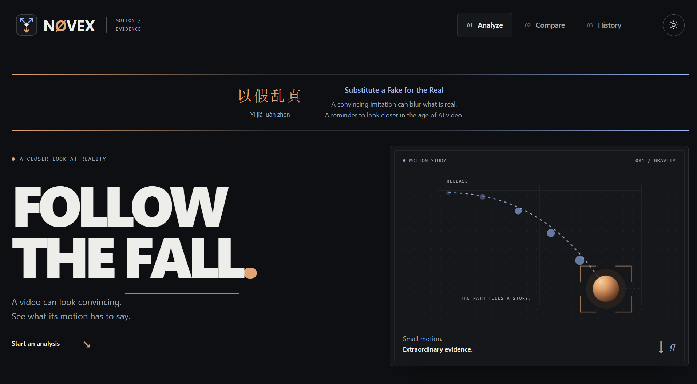
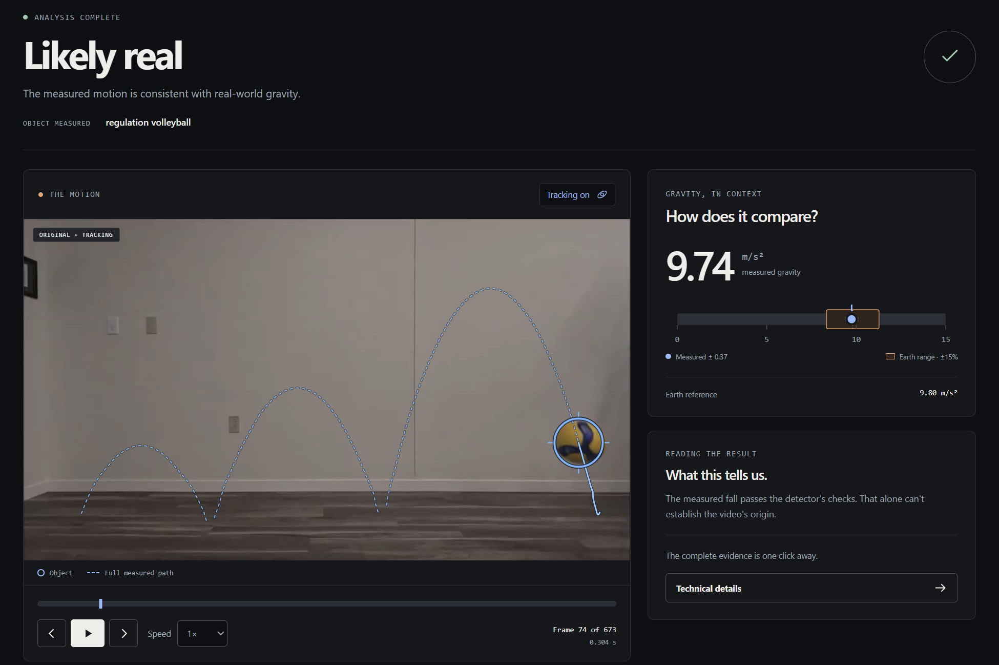
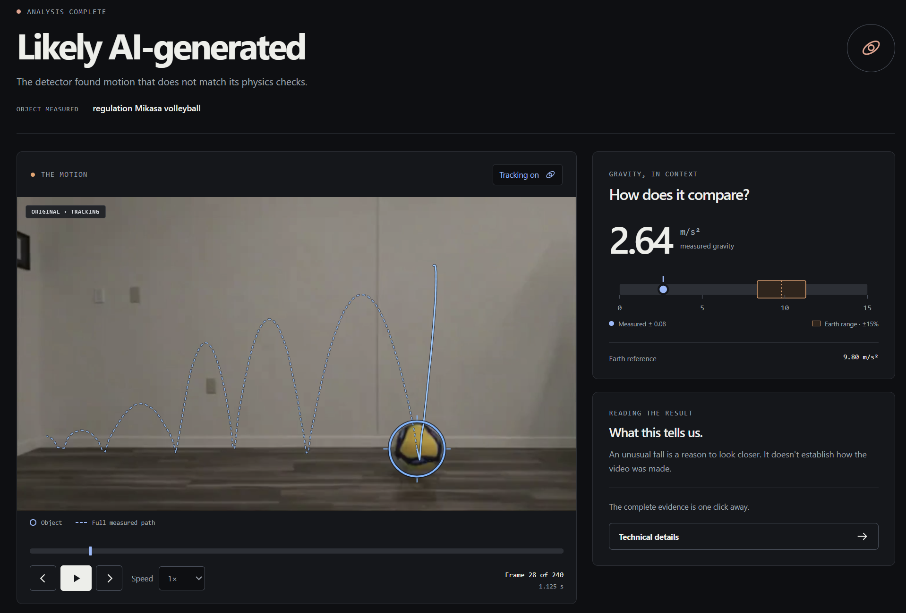
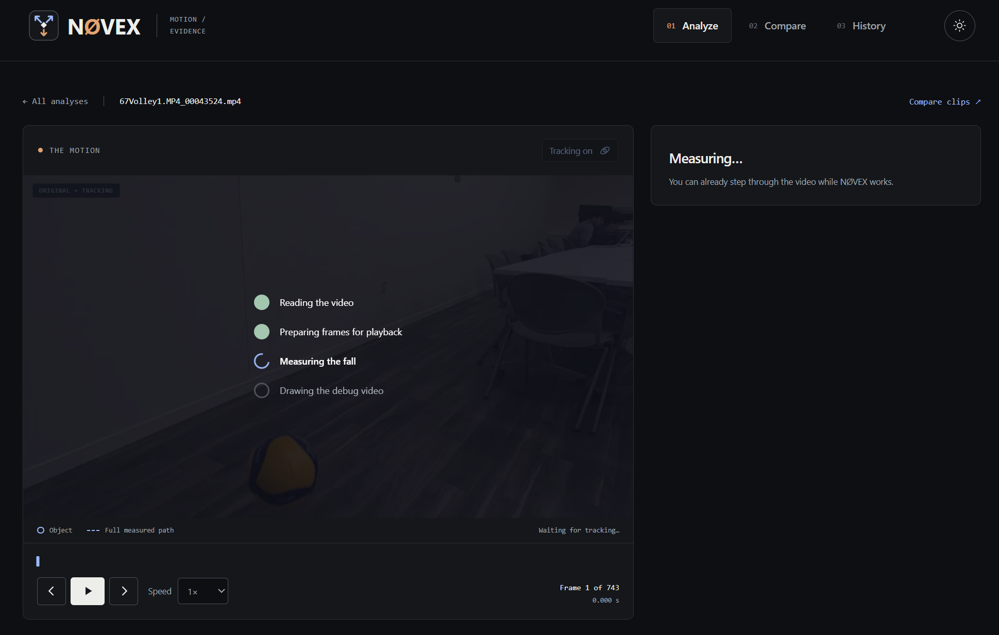

<p align="center">
  
</p>

<h1 align="center">NØVEX</h1>

<p align="center">
  <strong>Follow the fall.</strong><br>
  Physics-based video analysis · Built for SwampHacks
</p>

NØVEX explores whether the way objects move can help us spot AI-generated video.
Upload a clip of something falling or bouncing, and it tracks the object, estimates
its acceleration, and checks how closely the motion matches physical expectations.
The website puts the measured path, gravity estimate, and supporting evidence beside
the video so you can see what led to the result.

> **SwampHacks prototype — a proof of concept.** This project will not work 100% of
> the time. It can flag genuine footage, miss AI-generated footage, or return an
> inconclusive result. NØVEX evaluates physical plausibility; its output cannot
> establish whether a video is authentic or how it was made.



## What you can do

- **Analyze a clip:** upload a video, choose the falling object or identify it
  automatically, and follow the processing stages.
- **See the measurement:** view the object highlight and its measured path directly
  on the result video, with playback speed controls and frame stepping.
- **Compare gravity:** see the estimated acceleration, uncertainty, and the
  detector's Earth-gravity comparison range on a horizontal gauge.
- **Compare two clips:** upload two videos or select two saved analyses, then use
  linked or independent playback. Linked playback follows elapsed video time;
  it does not automatically align the moments when the objects are released.
- **Inspect the evidence:** open **Technical details** for checks, charts, debug
  video, the complete result JSON, and data downloads.
- **Revisit results:** use History to reopen analyses. Light and dark themes and
  responsive layouts support different screens.

## A look at the results

These are example outputs from the prototype, not a benchmark or an accuracy claim.

| Example output: likely real | Example output: likely AI-generated |
| --- | --- |
|  |  |
| The displayed estimate is close to the Earth reference. | The displayed estimate falls outside the comparison range. |

<details>
<summary>See the analysis in progress</summary>

The video preview becomes available while the measurement continues. The progress
list shows which stage is active.



</details>

## How it works

1. **Read the video.** Decode frames and timestamps, then estimate camera motion
   and track objects through the clip.
2. **Establish a scale.** Use a selected object, a supplied size, or an optional
   identification model to estimate how image distances translate into real distances.
3. **Measure the motion.** Fit trajectories and examine acceleration, falls, and
   bounces. Compare the measurements with physical expectations, including gravity
   near Earth's surface at approximately **9.8 m/s²**.
4. **Show the evidence.** Return a result with measurements, uncertainty, and the
   checks behind it. The website reads these results from the shared Python analyzer.

The measurement pipeline uses computer vision and physics. Optional pretrained
models help identify objects and estimate their size; using the basic workflow does
not require training a model.

## Run the website locally

You need **Python 3.10+**. From the repository root, create a virtual environment:

```bash
python -m venv .venv
```

Activate it using the command for your terminal:

**Windows PowerShell**

```powershell
.\.venv\Scripts\Activate.ps1
```

**macOS / Linux**

```bash
source .venv/bin/activate
```

Install the core dependencies and start the website:

```bash
python -m pip install -r requirements.txt
python -m novex.site
```

Open **[http://localhost:8080](http://localhost:8080)**. Try a bundled synthetic
example, or upload a short clip with a clearly visible falling object. Select its
preset or enter its size if automatic identification is unavailable.

**No API key or GPU is required for the basic workflow with a manually selected
object or size.** There is no separate frontend build step.

Uploads and results are stored in `site_data/` by default. The server supports
`--port`, `--host`, and `--data` options. This local demo uses shared history;
user accounts and access controls are outside the current prototype.

## Optional automatic object identification

### Gemini

Install the optional SDK in the same Python environment as the website:

```bash
python -m pip install "google-genai>=1.30"
```

Set the key in the **server's environment** before starting it. For example:

**Windows PowerShell**

```powershell
$env:GEMINI_API_KEY = "your-api-key"
python -m novex.site
```

**macOS / Linux**

```bash
export GEMINI_API_KEY="your-api-key"
python -m novex.site
```

`GOOGLE_API_KEY` is also supported. If the key is already saved in your environment,
open a new terminal and restart the server so it inherits the value. The app does
not automatically read a `.env` file or search for a key file.

Choose **Identify automatically** in the upload form. When configured, the core
tries Gemini first and falls back to CLIP if Gemini cannot provide a usable
identification and CLIP is available. Check **More options → Automatic
identification status** to see which providers are configured.

Keep keys out of the repository and browser code. For a hosted instance, use the
hosting service's environment-variable or secret settings. With Gemini enabled,
selected video frames and object crops are sent to Google's API for identification.

### CLIP

To enable local object identification and the Gemini fallback:

```bash
python -m pip install torch torchvision "transformers>=4.50" pillow
```

CLIP downloads pretrained model weights on first use and can then run locally on
CPU. If neither provider is available, selecting an object or entering its measured
size still lets you use the core workflow.

## Reading a result

| Result | What it means |
| --- | --- |
| **Likely real** | The measured motion passed the detector's checks. Plausible motion alone does not prove authenticity. |
| **Likely AI-generated** | The measured motion did not match the detector's physical expectations. Editing, incorrect scale, or measurement errors can also produce this result. |
| **Inconclusive** | The available evidence or measurement quality was insufficient for a useful decision. |

For the best chance of a useful measurement, start with a well-lit clip containing a
compact object, a clear view of its fall, and a known physical size. A longer visible
flight and a steady camera help.

Current limitations include:

- **Tracking and camera geometry:** blur, occlusion, a small object in the frame,
  complex backgrounds, camera movement, and perspective can distort measurements.
- **Object identity and size:** a mistaken identification or size estimate changes
  the conversion from pixels to metres and can change the verdict.
- **Playback speed:** the website currently uses the core's default assumption that
  footage plays at its original speed. Slow motion or retiming can look physically
  inconsistent. The command line offers an opt-in `--slowmo` mode for clock analysis.
- **The motion itself:** clips without a clear fall, very short trajectories, and
  objects strongly affected by air resistance may not provide enough evidence.
- **Generalization:** synthetic examples and selected successful clips do not
  establish accuracy across real-world or AI-generated video. Physically plausible
  synthetic footage can pass the checks, and genuine footage can fail them.

## Command-line tools and demos

The same analyzer can run without the website:

```bash
# Analyze a clip using a known object size.
python -m novex analyze my_drop.mp4 --object ping-pong

# Save a debug video and the full result.
python -m novex analyze my_drop.mp4 --object ping-pong --debug-video --json result.json

# Allow clock-based interpretation of slow-motion footage.
python -m novex analyze slow_motion.mp4 --object ping-pong --slowmo

# Inspect all analysis options.
python -m novex analyze --help
```

The repository also includes synthetic clip generation, batch analysis, optional
Depth Pro and SAM 2 integrations, and a separate webcam/drop-tower demo. For the
current website shown above, use **`python -m novex.site`**. The
`python -m novex serve` command launches the separate tower-demo interface.

## Project structure

| Location | Purpose |
| --- | --- |
| [`novex/site/`](novex/site/) | Current website, job API, video previews, and comparison interface |
| [`novex/analyze.py`](novex/analyze.py) | Shared analysis pipeline |
| [`novex/track.py`](novex/track.py), [`physics.py`](novex/physics.py), [`checks.py`](novex/checks.py), [`verdict.py`](novex/verdict.py) | Tracking, motion fits, physical checks, and result logic |
| [`novex/identify.py`](novex/identify.py), [`gemini.py`](novex/gemini.py), [`catalog.py`](novex/catalog.py) | Object identification, optional Gemini integration, and object sizes |
| [`novex/web/`](novex/web/), [`novex/live.py`](novex/live.py), [`novex/tower.py`](novex/tower.py), [`firmware/`](firmware/) | Separate live-camera and drop-tower demo |
| [`tests/`](tests/), [`novex/site/tests/`](novex/site/tests/) | Core and website checks |

## Development

Run the Python checks with:

```bash
python -m pip install -r requirements-dev.txt
python -m pytest tests novex/site/tests -q
```

The frontend renderer checks use Node.js:

```bash
node --test novex/site/tests/test_visuals.cjs
```

These checks exercise implementation behavior; they do not establish real-world
video-detection accuracy. Useful next steps include broader evaluation on genuine,
edited, and generated clips, more reliable tracking in difficult scenes, and better
calibration of uncertainty. Reproducible bug reports with the object size, capture
conditions, and observed result are welcome.

## Acknowledgments

NØVEX is a **SwampHacks hackathon project**. Development included AI assistance from
Claude and ChatGPT/Codex. Optional model integrations use existing pretrained models
or cloud APIs.

The interface's visual direction draws inspiration from Hyperplexed's web-design
work; references are recorded in the [website notes](novex/site/README.md#design-references).
